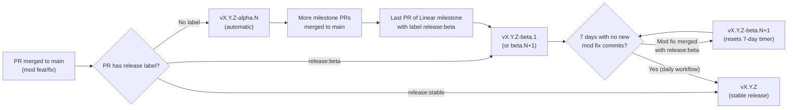

# Releasing Cobbleloots

Cobbleloots uses a **single trunk (`main`) + tags** release model. Pull Requests branch from `main` and merge back into `main` without stacking. Release channels (`alpha`, `beta`, `release`) are driven by Git tags, PR labels, and automation — not separate channel branches.

---

## 1. Release Lifecycle



- **Linear Milestones**: Each Linear milestone represents one update (e.g., *Hidden Treasures Update*). When `/factory` picks up the last open ticket in a milestone, it adds the `release:beta` label to the PR.
- **GitHub Labels**:
  - `release:beta` — promotes the merged PR to `vX.Y.Z-beta.1` (or `vX.Y.Z-beta.N+1` if a beta cycle is already active).
  - `release:stable` — forces a stable `vX.Y.Z` release directly from a PR.
- **Daily Promotion (`Promote Beta to Stable`)**: `.github/workflows/promote-stable.yml` runs daily at 12:00 UTC using only local `git` history (no secrets needed for the check). If the latest unreleased beta tag is at least **7 days old** and no new mod `fix` commits have landed since it, it publishes `vX.Y.Z` on the commit of that beta tag.
- **Manual Fallback**: `Release Automation` (`.github/workflows/release.yml`) supports `workflow_dispatch` with `channel` (`alpha`, `beta`, `release`) and `dry_run`.

---

## 2. Semantic Versioning for Mods

Versions follow SemVer with the Minecraft version as build metadata (`+1.21.1`):

```text
MAJOR.MINOR.PATCH[-prerelease.N]+<mc_version>
```

Examples: `2.5.0-alpha.4+1.21.1`, `2.5.0-beta.1+1.21.1`, `2.5.0+1.21.1`.
Git tags use `vMAJOR.MINOR.PATCH[-prerelease.N]` (e.g. `v2.5.0`), while JAR filenames and platform metadata attach the Minecraft version from `gradle.properties` (`minecraft_version`).

| Bump | Meaning | Conventional Commit Trigger |
| :--- | :--- | :--- |
| **Major (`X.0.0`)** | Breaks existing worlds, configs, or datapacks, or drops support for a Minecraft or Cobblemon version. | `!` or `BREAKING CHANGE:` on a mod commit |
| **Minor (`x.Y.0`)** | New gameplay or player-facing content. | `feat` on a mod commit |
| **Patch (`x.y.Z`)** | Bug fixes without new content. | `fix` on a mod commit |

### Commit Types & Empty Release Filtering

The commit type (and PR title, since squash/merge uses it as the commit message) must reflect the **player-facing effect**:

- **Publishes a release**: `feat`, `fix`, or any breaking change touching mod code/resources under `common/`, `fabric/`, or `neoforge/`.
- **Does NOT publish**: `build` (Gradle/dependencies), `ci` (GitHub Actions), `test`, `chore` (tooling/scripts/agents), `docs`, `refactor`, `style`, `perf`, `revert` (unless marked breaking).
- **Automatic path & scope filtering (`scripts/release.py`)**:
  - Commits whose scope is in `TOOLING_SCOPES` (including `build`, `gradle`, `ci`, `docs`, `scripts`, `release`, `agents`, etc.) are ignored.
  - Commits touching only `*.gradle`, `*.gradle.kts`, `gradle.properties`, `gradle/`, or `src/test/` (in any subproject) do not count as mod commits.

---

## 3. Release Procedures

### Alpha (Automatic)

1. Open a PR from a branch off `main` targeting `main` (no `release:*` label).
2. Add a player-facing changelog fragment in `.changelog/<LINEAR-ID>.md` if the change affects players or admins.
3. Ensure the PR title uses `feat(...)` or `fix(...)` only when the change has player-facing mod impact.
4. Merge the PR into `main`.
5. `Release Automation` detects the mod commit, bumps the alpha cycle (`vX.Y.Z-alpha.N`), consumes `.changelog/` fragments, updates `gradle.properties` and `CHANGELOG.md`, tags the commit, and publishes to GitHub Releases, Modrinth, and CurseForge.

### Beta (Milestone Completion & Fixes During Beta)

1. On the **final PR of a Linear milestone** (or any bug-fix PR merged during an active beta), add the `release:beta` label on GitHub.
   - `/factory` applies `release:beta` automatically when the ticket is the last open issue in its Linear milestone.
2. Merge the PR into `main`.
3. `Release Automation` inspects the merged PR's labels via the GitHub API (`GITHUB_TOKEN`):
   - First beta of the cycle: inherits the ongoing alpha core version (`vX.Y.Z-alpha.N` → `vX.Y.Z-beta.1`).
   - Subsequent beta fixes: increments the beta number (`vX.Y.Z-beta.1` → `vX.Y.Z-beta.2`) and restarts the 7-day soak timer.

### Stable (Automatic After 7 Days)

1. No manual action is required after a beta is published.
2. Every day at 12:00 UTC, `Promote Beta to Stable` runs:
   ```bash
   python scripts/release.py --branch main --check-stable-promotion
   ```
3. If the latest unreleased `vX.Y.Z-beta.N` tag is at least **7 days old** and no new mod `fix` commits exist between that tag and `main`:
   - The workflow checks out the exact beta tag commit so untested post-beta commits on `main` are never included.
   - It runs `Release Automation` with `channel=release`, compiles the `vX.Y.Z` JARs, tags `vX.Y.Z` (fast-forwarding `main` if `main` has not moved, or pushing the tag alone if `main` has moved ahead), and publishes to GitHub Releases, Modrinth, and CurseForge.
4. If a mod `fix` lands during the 7-day window, promotion is blocked. Label the fix PR with `release:beta` so `vX.Y.Z-beta.N+1` is published and a fresh 7-day window begins.

### Hotfix (Urgent Fix on a Published Stable Version)

Use a temporary branch from the affected stable tag when `main` already contains unreleased features that should not ship in the patch:

1. Create a temporary hotfix branch from the affected stable tag:
   ```bash
   git fetch --tags origin
   git checkout -b hotfix/v2.5.0 v2.5.0
   ```
2. Apply the fix commit (`fix(<scope>): ...`) and add `.changelog/<LINEAR-ID>.md`.
3. Verify the build locally (`./gradlew build`).
4. Prepare and publish the patch release (`v2.5.1`):
   - Push the branch and run `Release Automation` via **Actions → Release Automation → Run workflow**, selecting the `hotfix/v2.5.0` branch and `channel=release` (test with `dry_run=true` first), **or** run locally:
     ```bash
     python scripts/release.py --branch hotfix/v2.5.0 --channel release
     ```
5. Bring the fix back into `main` so future releases include it:
   ```bash
   git checkout main
   git pull origin main
   git cherry-pick <fix-commit-sha>
   ```
   Open a PR to `main` (or push if permitted) and delete the temporary `hotfix/v2.5.0` branch once merged.

### Previous Minecraft Version (`mc/<version>`)

When Cobblemon updates to a new Minecraft version, Cobbleloots maintains only the **current** Minecraft version on `main` and the **previous** Minecraft version on a maintenance branch (`mc/<version>`), which accepts **bug fixes only**:

1. Before upgrading `main` to the new Minecraft version, create the maintenance branch from the last stable tag of the previous version:
   ```bash
   git fetch --tags origin
   git checkout -b mc/1.21.1 v2.5.0
   git push -u origin mc/1.21.1
   ```
2. To backport a bug fix to the previous Minecraft version:
   - Branch from `mc/1.21.1` (e.g., `ripio/fix/dev-99/backport-crash`).
   - Open a PR targeting `mc/1.21.1`.
   - `Gradle CI` and `Documentation CI` validate `mc/**` PRs automatically (GitHub Pages deploys from `main` only).
   - Add `release:stable` (or `release:beta` to test first) before merging so `Release Automation` publishes `v2.5.1` for Minecraft `1.21.1`.
3. When Cobblemon moves forward again, stop maintaining the older `mc/<version>` branch.

---

## 4. How to Force or Skip a Promotion

### Force Beta or Stable
- **From a PR**: add `release:beta` or `release:stable` before merging to `main` (if both labels are present, `release:stable` takes precedence).
- **Without a PR (Manual Dispatch)**:
  1. Go to **GitHub → Actions → Release Automation → Run workflow**.
  2. Choose the target branch (`main`, `mc/<version>`, or a `hotfix/*` branch).
  3. Select `channel`: `alpha`, `beta`, or `release`.
  4. Optionally check `dry_run` first to inspect the computed version and release notes without pushing tags or publishing.

### Skip or Delay a Promotion
- **Prevent an automatic alpha on a non-gameplay PR**: use a non-publishing PR title/commit type (`build`, `ci`, `test`, `chore`, `docs`, `refactor`). Never use `feat` or `fix` for build/tooling changes.
- **Delay automatic beta → stable promotion**:
  - Merge a mod `fix` PR (with `release:beta`) to ship `beta.N+1` and restart the 7-day window; **or**
  - Temporarily disable **Actions → Promote Beta to Stable** (`Disable workflow`) until ready, then re-enable it.

---

## 5. What to Do If a Release Goes Wrong

### Case A: Workflow Failed Before Tagging or Publishing
- Fix the issue in a normal PR on `main` and merge. No tag or external version exists to clean up.

### Case B: Tag Created, But Publish to Modrinth / CurseForge Failed
1. Inspect the failed `Release Automation` logs to fix the root cause (e.g., transient API error or missing secret).
2. If **neither** Modrinth nor CurseForge received the version and you want to re-run the same tag:
   ```bash
   gh release delete vX.Y.Z --yes
   git push origin :refs/tags/vX.Y.Z
   git tag -d vX.Y.Z
   ```
   Revert the `chore(release): vX.Y.Z [skip ci]` commit on `main` if needed, then re-run `Release Automation` via `workflow_dispatch`.
3. If only one platform succeeded (e.g., Modrinth uploaded, CurseForge failed), upload the missing JARs manually or run `python scripts/publish.py publish --no-modrinth --yes` locally from the tagged commit rather than deleting the tag.

### Case C: Broken Build Already Published to Modrinth / CurseForge
- **Never delete and reuse a published version number.** Players, launchers, and platform caches have already seen that version.
- Immediately **archive or unlist** the broken version on Modrinth and CurseForge if it causes crashes or world corruption, and add a warning banner to the GitHub Release notes.
- Ship a forward fix as soon as possible:
  - During alpha/beta: merge a `fix(...)` PR (with `release:beta` if in beta) to publish `alpha.N+1` / `beta.N+1`.
  - After stable: merge a `fix(...)` PR with `release:stable` (or use the hotfix procedure) to publish `vX.Y.(Z+1)`.
