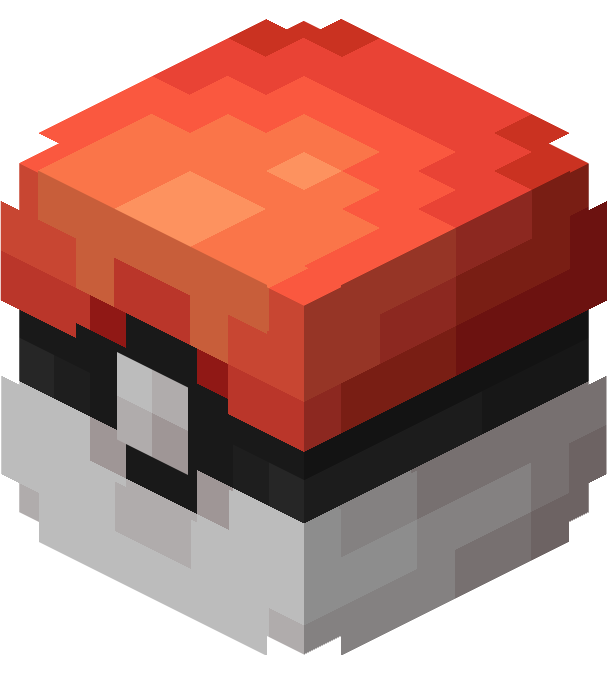

# Loot Balls

{width=120, align=right}

Loot balls are special entities in the Cobbleloots mod that can be found in the world or obtained through various means. When opened, these Loot Balls will give players random items based on predefined loot tables.

Navigate the sidebar menu to learn more about the different types of loot balls and their properties.

## Obtaining

Loot balls can be obtained in the following ways:

- **World generation**: Placed naturally when new chunks generate.
- **Random spawning**: Periodically spawns near players.
- **Fishing**: Hooked on successful catches while fishing with Cobblemon **Poké Rods**.

### Fishing

Fishing provides a peaceful way to collect Loot Balls with aquatic-themed rewards:

- **Base Chance & Luck of the Sea**: By default, each successful Poké Rod catch has a **5%** base chance to also yield a Loot Ball (`fishing_chance = 0.05`). Enchanting your Poké Rod with **Luck of the Sea** multiplies this chance by `1.4` per level (`7.0%` at Level I, `9.8%` at Level II, and `13.72%` at Level III).
- **Aquatic Variants**: Marine and fluvial biomes prioritize themed Loot Balls—[**Dive Loot Ball**](tier-2-uncommon/dive.md) in oceans and coasts, [**Lure Loot Ball**](tier-2-uncommon/lure.md) (exclusive to fishing) across oceans, rivers, coasts, and swamps, and [**Net Loot Ball**](tier-2-uncommon/net.md) in rivers, swamps, oceans, and coasts. Matching Poké Rods (Dive Rod, Lure Rod, Net Rod) further boost their corresponding Loot Balls.
- **Configuration**: Fishing can be toggled, rebalanced, or restricted per dimension in the [Configuration](../guides/configuration.md#fishing-mechanics-and-luck-of-the-sea) guide.

